# 🧠 Multimodal Attendance & Engagement Agent

> **AI-Powered, Privacy-Preserving Classroom Intelligence System**  
> Integrating **Computer Vision**, **Audio Signal Processing**, and **Google Gemini 2.0 Flash Agent Reasoning**.

[](https://www.python.org/)
[](https://flask.palletsprojects.com/)
[](https://ai.google.dev/)
[]()
[]()

---

## 📌 Executive Summary

In educational institutions and corporate training environments, attendance tracking remains largely manual or limited to basic biometric sensors that fail to capture meaningful engagement and participation context. These traditional approaches are time-consuming, prone to inaccuracies, and provide zero insight into learner attention, interaction patterns, or session pacing.

The **Multimodal Attendance & Engagement Agent** was engineered as an assistive classroom intelligence platform that moves beyond simple presence detection. By fusing **head pose estimation**, **inactivity tracking**, and **acoustic turn-taking telemetry**, the system provides instructors with real-time feedback, automated attendance rosters, and AI-driven pedagogical suggestions without compromising student privacy.

---

## 🎯 The 3 Curriculum Scenarios

| Scenario | Focus Area | Technical Mechanism | Key Result |
|---|---|---|---|
| **Scenario 1** | **Automated Attendance Tracking** | Sustained presence state machine with temporal sliding window | Filters out 18-second transient passers-by while accurately verifying sustained enrolled learners; generates timestamped CSV logs. |
| **Scenario 2** | **Engagement & Session Dynamics** | Multimodal signal fusion (55% Vision + 35% Audio + 10% Motion) | Visualizes 45-minute lecture timeline, flagging cognitive fatigue troughs at min 20 (54%) and interaction peaks at min 30 (92%). |
| **Scenario 3** | **AI-Driven Teaching Suggestions** | Google Gemini 2.0 Flash + Text-to-Speech Engine | Delivers non-intrusive pedagogical prompts (think-pair-share checkpoints, pacing adjustments, spatial circulation) with spoken audio alerts. |

---

## 🏗️ System Architecture

```mermaid
flowchart TD
    subgraph Client["Frontend Layer (HTML5 / CSS3 / JS)"]
        UI[Glassmorphic SaaS Dashboard]
        LiveStudio[Live Webcam & Audio Spectrum Studio]
        ScenNav[Scenario 1, 2, 3 Switchers]
        ChartModule[Chart.js Dynamics & Heatmaps]
        TTSBridge[Web Speech / Audio Alert Player]
        CodeConsole[Interactive Python Sandbox Console]
    end

    subgraph API["Flask API Gateway & Route Handlers"]
        AttRoute["/api/attendance (Sustained Tracker & CSV)"]
        EngRoute["/api/engagement (Pose & Heatmap)"]
        AudRoute["/api/audio (VAD & Acoustic Energy)"]
        SugRoute["/api/suggestions (Pedagogical Copilot)"]
        CodeRoute["/api/code (Sandboxed Executor)"]
        AnlRoute["/api/analytics (Reports & SVG Heatmap)"]
    end

    subgraph Core["Services & Multimodal AI Layer"]
        VisionMod[Vision Module: Yaw/Pitch/Roll & EAR]
        AudioMod[Audio Module: RMS dBFS & ZCR VAD]
        FusionEng[Multimodal Fusion Engine: 0.55V + 0.35A + 0.10M]
        GeminiAgent[Google Gemini 2.0 Flash + Offline Heuristic Agent]
        TTSEngine[Text-to-Speech Wave Synthesizer]
        CodeExec[Python Analytics Code Executor]
    end

    subgraph Storage["Storage & Persistence Layer"]
        RosterDB[(Student Roster JSON)]
        AudioStore[backend/storage/audio/*.wav]
        CodeStore[backend/storage/code/*.py]
        ReportStore[backend/storage/reports/*.svg]
    end

    Client --> API
    API --> Core
    Core --> Storage
```



---

## 🚀 Instant Standalone Preview (No Setup Required)

To inspect the system immediately without configuring Python or databases:
1. Navigate to:
   ```
   C:\Users\aruls\.gemini\antigravity\scratch\multimodal-attendance-agent\demo_preview\
   ```
2. Double-click **`index.html`** in your browser (**Chrome**, **Edge**, or **Firefox**).
3. Access all features:
   - Live Webcam & Microphone FFT spectrum analyzer.
   - Sustained presence attendance verification table and instant CSV download.
   - Multimodal engagement timeline chart & spatial seating heatmap.
   - AI Teaching suggestions with instant speech synthesis.
   - Sandboxed Python code generation and execution terminal.

---

## 💻 Full-Stack Local Installation

### Prerequisites
- **Python:** 3.8+ (Python 3.10+ recommended)
- **Browser:** Google Chrome, Firefox, or Edge

### 1. Clone & Navigate
```bash
cd C:\Users\aruls\.gemini\antigravity\scratch\multimodal-attendance-agent
```

### 2. Configure Environment
```bash
copy backend\.env.example backend\.env
```
*(Optional: Insert your `GEMINI_API_KEY` into `backend/.env`. If omitted, the system seamlessly operates in 100% offline rule-based heuristic mode).*

### 3. Install Dependencies
```bash
pip install -r backend/requirements.txt
```

### 4. Launch the Platform
```bash
# Windows
start.bat

# Linux / macOS
chmod +x start.sh && ./start.sh

# Or directly via Python
cd backend && python app.py
```
Open **`http://localhost:5000`** in your web browser.

---

## 🐳 Docker Deployment

Run with a single Docker Compose command:
```bash
docker-compose up --build
```
- **Backend API & Dashboard:** `http://localhost:5000`
- **Standalone Preview Container:** `http://localhost:8080`

---

## 🧪 Automated Test Suite

Run the full unit and integration test suite:
```bash
cd C:\Users\aruls\.gemini\antigravity\scratch\multimodal-attendance-agent
pytest tests/ -v
```

### Test Coverage Highlights:
- **`tests/test_vision.py`**: Validates sustained presence thresholding (transient 10s walk-by rejected, sustained 40s approved) and head pose orientation classifications.
- **`tests/test_audio.py`**: Validates RMS energy in dBFS, Voice Activity Detection (VAD), and teacher monologue vs student Q&A dynamics.
- **`tests/test_fusion.py`**: Validates the multimodal fusion formula, attention drop triggers (<60%), and spatial seating disparity calculations.
- **`tests/test_api.py`**: Validates all REST endpoints (`/api/health`, `/api/attendance/roster`, `/api/suggestions/generate`, `/api/code/execute`).

---

## 📡 REST API Reference

| Endpoint | Method | Description |
|---|---|---|
| `/api/health` | `GET` | Health check and system capabilities summary. |
| `/api/attendance/roster` | `GET` | Retrieve list of enrolled students. |
| `/api/attendance/session/<key>` | `GET` | Get timestamped attendance logs for scenario. |
| `/api/attendance/track-presence` | `POST` | Ingest real-time camera presence telemetry. |
| `/api/attendance/export/csv` | `GET` | Download official session attendance CSV. |
| `/api/engagement/timeline/<key>` | `GET` | Retrieve 45-minute multimodal engagement timeline. |
| `/api/engagement/fuse-telemetry` | `POST` | Fuse current vision, audio, and motion signals. |
| `/api/engagement/spatial-heatmap` | `GET` | Classroom row-by-row attention distribution. |
| `/api/suggestions/generate` | `POST` | Generate Gemini 2.0 Flash pedagogical intervention. |
| `/api/suggestions/synthesize-audio` | `POST` | Synthesize pedagogical suggestion into audio file. |
| `/api/code/generate` | `POST` | Generate Python analytical script. |
| `/api/code/execute` | `POST` | Safely execute Python script in sandbox. |
| `/api/analytics/session-summary` | `GET` | Retrieve comprehensive session intelligence report. |

---

## 🛡️ Privacy & Ethical Deployment

1. **Edge-Only Feature Extraction**: Raw camera frames and audio streams are processed in memory and immediately discarded.
2. **Biometric Vector Anonymization**: Only geometric telemetry (head pose angles, eye aspect ratio, bounding coordinates) and acoustic dBFS levels are logged.
3. **Offline Air-Gapped Operation**: The entire system can run without an internet connection, guaranteeing institutional compliance with student data privacy regulations (FERPA / GDPR).

---

## 👥 Contributors & Acknowledgements
- Developed for the **Multimodal Attendance & Engagement Agent** Curriculum.
- Powered by **Google Gemini 2.0 Flash**, **OpenCV**, and **Flask**.
